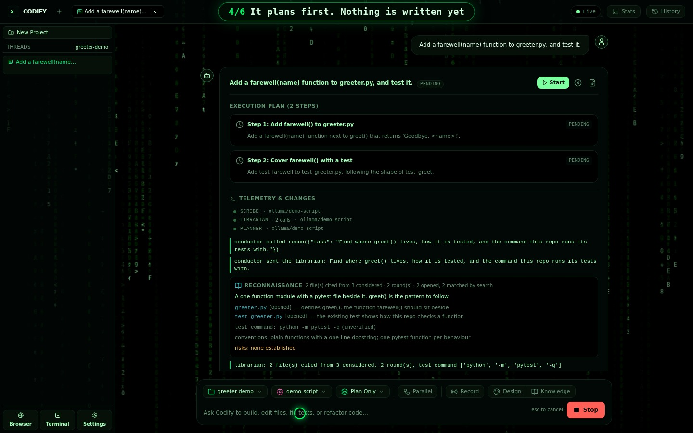
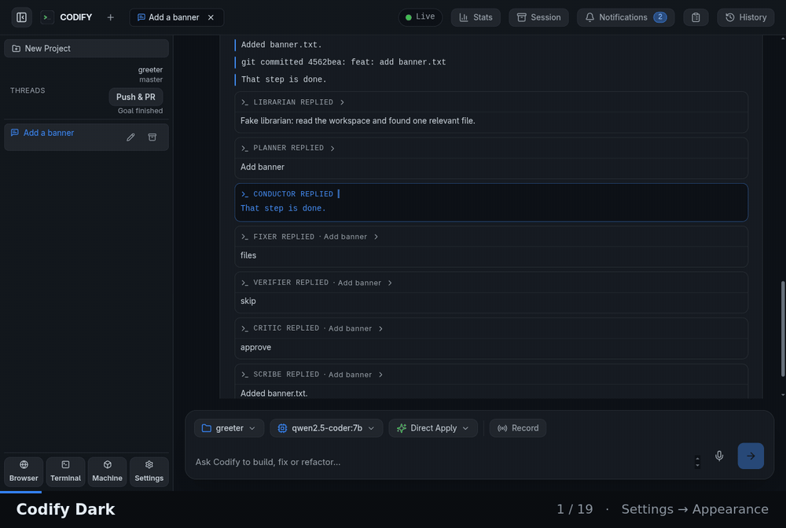

<div align="center">


# Codify

**A local-first, multi-agent coding assistant.**<br>
It plans, you approve, and every change is verified and committed on its own.

[](https://github.com/GeneticxCln/Codify/actions/workflows/check.yml)


[](LICENSE)

<br>

<a href="docs/media/demo.mp4">
  <picture>
    <source srcset="docs/media/demo.webp" type="image/webp">
    
  </picture>
</a>

<sub><b>The real app in the OLED CMatrix theme</b>, from choosing <b>Plan Only</b> to two verified commits. Parts of the
animation are sped up and carry a speed badge; <a href="docs/media/demo.mp4">the full-length MP4</a> is real time.
<a href="#-see-it-work">What is real in this clip, and what is scripted</a>.</sub>

<br>

[Quickstart](#-quickstart) ·
[How it works](#-how-it-works) ·
[Themes](#-appearance) ·
[Voice](#-voice) ·
[Security](#-security--invariants) ·
[Documentation](#-documentation)

</div>

---

**Codify** turns a plain-language request into a plan, waits for your approval, and then carries it out one verified
step at a time. A pre-flight gate rules on the request, a librarian reads your code, a planner writes the steps, and a
fixer, verifier, critic and scribe work each step in turn. Commands run in an allowlisted sandbox, each step is
committed on its own with only the files it wrote, and every stage streams live into a desktop app.

- **Plan first.** In **Plan Only** mode nothing is written until you press **Start**, and that is enforced by the
  engine's write gate, not by the UI.
- **Verified, not asserted.** The verifier runs your project's own tests and the critic audits the diff. A step that
  fails goes back instead of forward, and a critic that asks for changes pauses the goal for you.
- **Scoped commits.** A step commits *only* the paths it wrote. The engine never runs a bare `git add -A`.
- **Local-first.** The engine binds `127.0.0.1` behind a boot token, and API keys never reach SQLite or an API
  response. Run it on a local model, or point any role at a hosted one.
- **Your models, discovered live.** Eight providers are built in (Anthropic, OpenAI, Google, DeepSeek, OpenRouter,
  Groq, NVIDIA and Ollama), any OpenAI-compatible or Ollama-style endpoint can be added, and Codify ships no model list.
- **Nineteen themes**, shown in the [slideshow below](#-appearance) and swapped at runtime with no rebuild.

Everything below is specified in [`docs/`](docs/00-codify-architecture-overview.md). That set is the source of
truth; this file is the tour.

---

## 🎬 See it work

The clip is one request, start to finish, in the **OLED CMatrix** theme:

1. **Choose a mode.** *Plan Only* shows the plan and waits for you.
2. **Ask** in plain language: *"Add a farewell(name) function to greeter.py, and test it."*
3. **The gate rules, the librarian reads.** It opens `greeter.py` and `test_greeter.py`, and reports what it
   actually opened.
4. **A two-step plan**, and nothing has been written yet.
5. **Start.** For each step the fixer writes, the verifier runs `python -m pytest -q` in the sandbox, the critic
   reviews, and the scribe commits.
6. **Two commits**, `feat(greeter): add farewell()` and `test(greeter): cover farewell()`, each touching only its
   own file.

**What is real, and what is not.** It was recorded from the browser build of the UI (the same React app the
desktop shell loads), against a real engine on a scratch state directory: the gate, the conductor loop, the
write gate, the sandbox running pytest, the scoped git commits and every event on screen are the real thing.
**The model's replies are scripted**, so the clip is reproducible offline and takes no API key; a real model
decides differently and takes longer. The MP4 is real time and unedited. The animation above is the same recording with
the waiting cut down, and every sped-up stretch carries a badge.

---

## 🚀 Quickstart

```bash
git clone https://github.com/GeneticxCln/Codify.git
cd Codify
make doctor     # checks the machine, and prints the install command for anything missing
make setup      # creates .venv, installs the engine and dev tools, runs npm ci
make run-app    # builds the UI, embeds it, launches the app
```

`make doctor` is the list of what you need, kept honest by running it. In short:

| You need | Because |
|---|---|
| **Python 3.10+** with `venv` | The shell boots the engine as `python3 -m engine`, and 3.10 is a real deployment floor. |
| **Node 22.22.2+, 24.15+ or 26+** | The range jsdom supports, which the UI test suite inherits. |
| **Rust stable** with `rustfmt` | The Tauri shell. WebKitGTK 4.1 (2.40+), GTK 3, libsoup 3, librsvg, OpenSSL and `pkg-config` come with it. |
| **bubblewrap** and `unshare` | The Machine tab is a jailed shell, and its tests build real jails (an unprivileged overlay mount needs Linux 6.6+). The app runs without the overlay, with the project read-only in the machine. The same jail contains the commands a goal runs: **without a working jail, an approved goal's tests and scripts are refused** until you allow unjailed runs in Settings → Agents → Workspace command jail (`sandbox_unjailed_ok`). |
| A display | For the Tauri tests; `xvfb` is used automatically on a headless machine. |
| PipeWire's `pw-record` | Optional: only for dictation. |

A virtualenv rather than `pip install -r`: stock Ubuntu 24.04, Debian 12+ and Fedora refuse `pip install` into the
system Python (PEP 668). The Makefile and the shell both use `./.venv` when it exists, so nothing has to be activated.

The in-process **Laya gate** is optional and deliberately not part of `make setup`: the SDK brings torch and downloads
its checkpoints on first use. `make setup-laya` adds it, and `make doctor` says whether it is there. A package ships
without it and gates through the role's fallback model: [`docs/05`](docs/05-laya-system-1-gate.md),
[`docs/18`](docs/18-release-and-updates.md) §2.

<details>
<summary><b>Install a launcher, hot reload, or run the engine without the shell</b></summary>

<br>

```bash
make dev-app           # hot reload against the Vite dev server (needs cargo-tauri)
make install-local     # release build, plus a `codify` command and a menu entry
codify                 # from any directory, or from the applications menu
make uninstall-local   # removes exactly those three files
```

Codify targets Linux desktops and comes two ways. A **package** — a deb or an AppImage, built from a tag by
[`.github/workflows/release.yml`](.github/workflows/release.yml) and downloaded from the releases page — or the
**checkout**, which is what `make install-local` above puts in your applications menu: a `codify` command and a menu
entry under your own `~/.local`, no root involved. **Moving or deleting the checkout breaks the entry**, because the
launcher finds the project root from where it lives.

A package carries its own engine and the Python it runs on, so it needs no checkout and no Python of yours, only `git`
(which the deb installs). The checkout runs its own engine, and `CODIFY_ROOT=/path/to/Codify` points a package at a
checkout's instead — see [`docs/18`](docs/18-release-and-updates.md) §2 for what a package holds and leaves out. A
checkout build finds the checkout it was built in; starting it from another folder does not run that folder's engine
unless you opt in with `CODIFY_DEV_CWD=1`. The app
also has a **Check for updates** button on Settings → About, which asks GitHub for the newest release when you press
it and can download the package for the copy you are running. It never installs anything, and it asks GitHub only
when you press the button. The engine can also request a web page for the assistant, but only after you allow it in
Settings; otherwise the requests that leave the machine go to the model providers you configure.

A package you downloaded can be checked against its release's own `SHA256SUMS` before you install it:
`make verify-package` (or `make verify-package FILES=~/Downloads/Codify_1.0.0_amd64.deb`). That says the file is whole
and is the one that release published. It is not a signature — the checksums come from the same place the package did
— so it catches a truncated or re-uploaded file, not a hostile one; [`docs/18`](docs/18-release-and-updates.md) §5 is
what it does and does not claim.

> **Do not launch it with a bare `cargo run`.** That is a *dev* build: the window loads `http://localhost:5173`
> and shows a connection error unless a Vite dev server is already running, which looks exactly like an app whose
> panes are not wired.

> **Run from the checkout, the app needs a Python 3.10+ with the engine's dependencies** (`make setup`). The shell
> spawns `python3 -m engine` in the project root — or a package's own bundled engine, when it is one — and reads the
> `CODIFY_ENGINE token=… port=…` handshake from its stdout. If no engine is found the window says so rather than
> opening empty.

**If the window opens blank or black** (WebKitGTK 4.1 quirks, none of which apply on a normal GNOME or KDE
session): try `WEBKIT_DISABLE_DMABUF_RENDERER=1 codify` on some NVIDIA/Wayland combinations, or
`GDK_BACKEND=x11 codify` to go through XWayland.

**Checked on a real display, by hand** (the maintainer, not CI), on both Wayland and X11: CachyOS under Niri, a
Wayland compositor, and X11 through its XWayland. The window renders without graphical artifacts, the folder picker
opens the native XDG desktop portal dialog when `codify` is run from the project's `.venv`, and the `.desktop` entry
launches the app from the desktop launcher. It has not been run on GNOME or KDE.

**Engine without the shell**, for UI work:

```bash
make run-engine-preview   # terminal 1: starts the engine and prints the token and port
make dev-ui               # terminal 2: the standalone browser build
```

A browser tab has no shell to ask for a boot token, so it needs one pasted into the console once; the app tells
you the exact two `localStorage` lines when it needs them.

**Never touches your real `~/.codify`:** `CODIFY_HOME=/tmp/anything python3 -m engine` moves both the database
and the secrets file, and disables the OS keychain for that process, so a run pointed at its own store cannot
reach the real one.

</details>

---

## 🏛️ How it works

```
┌─────────────────────────────────────────────────────────────┐
│                    Codify Desktop App                       │
│  ┌─────────────────────────┐   ┌─────────────────────────┐  │
│  │  React 19 + TypeScript  │◄──┤      Tauri v2 Core      │  │
│  │   Tailwind CSS / Vite   │──►│   (Rust Subprocess Host)│  │
│  └─────────────────────────┘   └────────────┬────────────┘  │
└─────────────────────────────────────────────┼───────────────┘
                                              │ Spawns & supervises
                                              ▼ (Stdout Handshake)
┌─────────────────────────────────────────────────────────────┐
│                    Codify Engine Backend                    │
│  FastAPI (127.0.0.1:7430-7440, Bearer boot token)          │
│    │                                                        │
│    ├─ Laya System-1 gate — typed decisions, before any LLM  │
│    └─ Conductor loop — picks from 7 role slots              │
│       via moves + a loaded skill                            │
│       │                                                     │
│  ┌────┴─────────┬──────────────┬────────────┐  ┌─────────┐  │
│  │ FileSystem   │ Sandbox      │ Git        │  │ SQLite  │  │
│  │ (path jails) │ (allowlist)  │ (commits)  │  │  WAL    │  │
│  └──────────────┴──────────────┴────────────┘  └─────────┘  │
└─────────────────────────────────────────────────────────────┘
```

The component list behind that diagram and the invariants the engine holds to are in
[`docs/00`](docs/00-codify-architecture-overview.md). Read it before changing either tier.

### Eight roles, and a loop that orders them

A **pre-flight gate** rules on every goal before any model is called, then a **conductor** decides which of the
remaining seven roles run and in what order.

| Role | Runs | Ability |
|---|---|---|
| **Laya** (gate) | once per goal, before any model call | Typed decisions: intent, risk, calibrated prompt-injection. Blocks hostile requests; never writes files. |
| **Librarian** | once per goal, before planning (`recon`) | **Read only**: files, search, git history. Returns a checked evidence pack: paths it actually opened, conventions, the command this repo really runs. |
| **Design** | once per goal (`design`) | Reasons only. Locks the direction (tokens, components, constraints), obeying the workspace's brand contract when it has one. Emits the contract as text; never writes it. |
| **Planner** | once per goal (`plan`) | Reasons only. Decomposes goal + evidence into 1–20 steps with target paths. |
| **Fixer** | once per step (`write`) | **The only writer.** Proposes file creates, updates, deletions. |
| **Verifier** | once per step (`verify`) | **The only role that runs a command.** One allowlisted command; reports what actually happened. |
| **Critic** | once per step (`review`) | Audits the diff. `request-changes` pauses for a human; there is no auto-fix loop. |
| **Scribe** | once per step (`summarize`) | Progress notes and a conventional commit message. |


The familiar librarian → design → planner → fixer → verifier → critic → scribe order is the built-in `ship-a-change`
**skill**, not a compiled path: a request needing three of those seven gets three. The slot count is fixed; the order
is not. Independent steps of a `parallel` goal run concurrently, bounded by a configurable width. The conductor can
keep short notes for its next run of a step (`todo`) and, before there is a plan, put one question to you with options
you can click (`ask_user`). Neither is a new power. See [`docs/01`](docs/01-subagent-orchestration-spec.md),
[`docs/05`](docs/05-laya-system-1-gate.md) and [`docs/09`](docs/09-workspace-shell.md) §10.

### What the conductor can use

Every one of these is a move or a tool the engine defines. A skill, a workspace file or a model's reply cannot add
one, and none of them can write a file except through the approved plan.

| | What it does | Read more |
|---|---|---|
| **Review that argues back** | Optionally (Settings → Deep review, **off by default**), two fresh readers see only the request, the step and the diff, never the research the author used, before the critic decides. The critic still decides. | [`docs/01`](docs/01-subagent-orchestration-spec.md), [`docs/21`](docs/21-improvement-plan.md) |
| **Skills as data** | A library of built-in recipes (ship a change, prove, security review, health review and more) loaded on demand. A workspace can add or replace its own in `.codify/skills/`. A skill sequences moves that already exist and never gains a capability. | [`docs/01`](docs/01-subagent-orchestration-spec.md), [`docs/19`](docs/19-deepseek-stack-audit.md) |
| **Memory** | `recall` asks this workspace's own history *has this happened here before?* It is bounded and allow-listed, and what the brief mentions unprompted fades with age. | [`docs/10`](docs/10-agent-memory.md) |
| **The web** | Pages open inside Codify and are readable by the model (`read_page`). `fetch_page` reads a public page with the engine's own parser; Settings → Web pages narrows it to sites you list, or switches it off. | [`docs/09`](docs/09-workspace-shell.md), [`docs/12`](docs/12-scrapling-audit.md) |
| **Security review** | `scan_code` runs curated rule profiles (secrets, injection, crypto, deserialization, unsafe C, web) and returns ranked candidates at `path:line`, with what it did not look at. A workspace can add profiles as data. | [`docs/13`](docs/13-grepify-audit.md) |
| **Compiled files** | `analyze_binary` reads ELF, PE and Mach-O headers, symbols, imports and strings natively. Ghidra is an optional fallback. The file is never run. | [`docs/14`](docs/14-rea-audit.md) |
| **Where tokens went** | `audit_usage` reports wasted calls in **tokens** (there is no price table, on purpose), and explains a prompt-cache miss by what changed, from digests that hold no prompt text. | [`docs/15`](docs/15-xerg-audit.md), [`docs/21`](docs/21-improvement-plan.md) |
| **MCP servers** | Remote data sources over HTTPS only, with per-tool Read or Act authority. Act tools run only while a goal is approved and running. A server is never a new capability. | [`docs/20`](docs/20-mcp-admission-design.md) |
| **Models** | Discovered live from each provider, so one bad key never empties the picker. Each role can name a fallback, and Settings is the only place a role's model changes. | [`docs/02`](docs/02-settings-app-spec.md), [`docs/06`](docs/06-model-discovery.md) |

When a goal fails, the error block offers **Why did this fail?**: it reads the role's config, its credential state and
the provider's live catalog, and ranks cause above symptom.

---

## 🎨 Appearance

Nineteen themes ship in the box, and choosing one is a **runtime swap, not a rebuild**: a theme is a map of CSS
custom properties, so the whole app repaints with no component change and no restart.

<p align="center">
  
</p>

<sub>All nineteen, one slide each, in the order of the table below: seventeen of them with an animated backdrop of their own, and two (<b>Codify Dark</b> and <b>Still</b>) that ship no canvas at all. Each slide is one frame of the real app on a finished goal (the browser build, with a scripted model), so a backdrop is caught mid-motion. <b>OLED CMatrix</b> is the pure-black one with the green rain, and the one in the clip above.</sub>

| Theme | What it is |
|---|---|
| **Codify Dark** | The default contract: blue-grey surfaces, green reserved for status. No canvas. |
| **OLED CMatrix** | Pure black, with the rain drawn in `#003300`: the clip at the top of this page. |
| **Cyberpunk Neon** | Violet-black, a neon horizon grid and a banded sun in cyan and magenta, under a CRT veil. |
| **Neural Constellation** | A slow web of nodes that brightens and pulses while the agent is working. |
| **Cyberpunk HUD** | Amber instrumentation: corner brackets, two slow radar sweeps, a tick ladder. |
| **Bioluminescent Abyss** | Spores rising in the left and right gutters, fading out before the middle. |
| **Solar Flare** | A starfield and slow indigo-to-ultraviolet streams along the window's edges. |
| **Monochrome ASCII Rain** | The same rain in hex bytes and grey: no component of its own, just different tokens. |
| **Still** | No canvas at all. For long sessions, and for anyone who would rather have no weather than quiet weather. |
| **Winter Snow** | A clear cold night, and snow falling through the whole window. No lights, just weather. |
| **Festive Night** | Evergreen dark, gold and berry, and warm lights drifting up through the snow. |
| **Solarized Flare** | A monochrome amber CRT. Solar wind runs the gutters, and a heat pulse crosses them while a run is in flight. |
| **Cyber Organism** | Electric blue and cyan. Glowing nodes and branching tendrils in the margins, firing while a run is in flight. |
| **Event Horizon** | Obsidian and violet. Orbital streams curve away at the margins, and beams ignite while a run is in flight. |
| **Vector Wireframe** | Green or hot pink 1px line art. Rotating wireframe solids in the gutters, with a target reticle while a run is in flight. |
| **Liquid Mercury** | Platinum, steel and titanium. Viscous metallic waves climb the margins and go turbulent under load. |
| **Electric Arc** | Ink-blue and a lightning-white core. Arcs strike down both gutters, fork, and go out as fast as they came. |
| **Toxic Lab** | A fume hood at 3am. Reagent-green bubbles climb the gutters, wobble, and burst; failure is the amber the hazard tape is. |
| **Anon Fluid** | Green on black and no name on it. Data runs sideways through the gutters as a liquid column, and a run in flight shears it into blocks. |

Four constraints hold every one of them:

- **A theme is data.** It publishes CSS variables; a backdrop asks whether the active theme published them. The
  last theme added was five lines of tokens and no new code.
- **One clock, one budget.** Every effect runs through `useAtmosphereCanvas`, which owns the canvas size cap, a
  30 FPS accumulator, and exactly one static frame under `prefers-reduced-motion`.
- **Decoration is never under the words being read.** Content surfaces stay opaque, and the canvas fades itself
  out at its edges — painted into its own pixels, not a CSS mask — before it reaches the chrome.
- **A theme may restate the status tones; it may not renegotiate them.** All six or none, and `danger` and
  `warning` stay on the warm arc: a user who learned that orange means *needs attention* was owed that much.

The whole window also **scales**: Settings → Appearance → *UI scale* (100 to 175%, **125% by default**), or
`Ctrl +`, `Ctrl -` and `Ctrl 0` from the keyboard. The type ramp and spacing are rem, so text, icons and padding
grow together, and the xterm terminal follows too.

Any theme can be **recoloured without being forked**: the Appearance pane offers each theme's accent plus the
weather variables its own backdrop reads, labelled with what they draw. A proposal is **clamped, not accepted
blindly**: it keeps its hue and saturation and has its lightness moved until it clears 4.5:1, and a colour that
cannot be made readable is refused outright. Schemes export and import as one readable JSON file.

One surface is not reachable by swapping custom properties, and it is the honest exception to *the whole app*:
xterm.js paints its own canvas and takes concrete colour strings. The one surface CSS cannot reach is the one that
needed it. The terminal follows the theme by reading it out of the document: `ui/src/terminalTheme.ts` maps all
twenty of xterm's colours onto variables a theme publishes, and the pane re-reads them on every switch, so a
terminal opened before you changed theme is not left behind. Before that, it was the one grey-blue box in an OLED
app that was otherwise black and phosphor.

---

## 🎙️ Voice

You can speak a prompt instead of typing it, and have answers read back to you.

- **The mic beside Send** puts what you said into the prompt at the caret. It never sends: you still press
  Send. Esc while recording throws the recording away.
- **Read aloud** sits under each answer. Turn on *Read each answer aloud as it arrives* in **Settings → Audio**
  and new answers read themselves. Answers already in a thread you open never do.

Both go through a speech provider you choose in **Settings → Audio**. Any server that speaks the OpenAI audio
API (`/audio/transcriptions`, `/audio/speech`) works:

| Setup | What to choose |
|---|---|
| **Fully local**: nothing leaves the machine | Run a speech server such as speaches or LocalAI on `127.0.0.1`. Choose *Custom Provider…* and give it a slug (`localspeech`) and its **Server address** (`http://127.0.0.1:8000/v1`). It needs no key. |
| **Hosted** | `openai` or `groq`, with its key under **Provider Keys**. |

Model and voice names are the provider's own, and Codify keeps no list of them.

The engine, not the webview, records the microphone, using PipeWire's `pw-record`. It records only while you
dictate, for at most two minutes, and deletes the recording once it has been transcribed. If PipeWire's tools are
missing, `make doctor` says so as a note, not a failure; everything else runs without them. Details:
[docs/09 §9](docs/09-workspace-shell.md), [docs/04 §3.0.2](docs/04-engine-data-and-runtime.md) and
[docs/03 §1.9](docs/03-security-and-roadmap.md).
## Working surfaces

| | |
|---|---|
| **Editor** | **Ctrl+K**, type part of a file's name, and it opens in its own tab. The assistant can see it (`read_editor`), open a file and range (`open_in_editor`) and change the open text (`edit_editor`), but it **never saves**: its edit is unsaved text marked as its own, and the file changes only when *you* press Save. [`docs/09`](docs/09-workspace-shell.md) §13 |
| **Machine** | A Linux shell in a bubblewrap jail, in a tab of its own, on its **own copy** of your project: **your files are never written**, it has no credentials, and it has no network unless you open it with one. If a jail cannot be built, nothing starts. It is a jail, **not a virtual machine**. The assistant can `read_machine`, `run_in_machine`, `key_in_machine` and `reset_machine`, but cannot open one. [`docs/09`](docs/09-workspace-shell.md) §14, [`docs/03`](docs/03-security-and-roadmap.md) §1.11 |
| **Split panes** | A chat beside a terminal, an editor or a browser page: right-click a tab, or **Ctrl+.**. A narrow window draws one pane. [`docs/09`](docs/09-workspace-shell.md) §12 |
| **Clipboard history** | What you copied, cut or pasted *inside Codify*, kept in this window and never sent anywhere. Anything shaped like a key or password is refused (a heuristic, not a guarantee). [`docs/09`](docs/09-workspace-shell.md) §11 |

---

## 🔒 Security & Invariants

1. **Loopback only.** The engine binds `127.0.0.1` on ports `7430–7440`.
2. **Boot token.** Every HTTP and WS request requires `Authorization: Bearer <token>`, created once per state
   directory and kept at `~/.codify/boot_token` (`0600`) so a client stays authenticated across restarts.
   `CODIFY_BOOT_TOKEN` overrides it.
3. **Path containment.** All file operations verify realpath containment; escapes raise `PathEscapeError`, and a
   workspace root that is your home, a system directory or a credentials directory is refused, so an approved
   goal cannot rewrite `~/.bashrc`.
4. **Command sandboxing.** Commands pass an allowlist (`pytest`, `npm test`, `cargo test`, `go test`, linters and type-checkers
   such as `ruff check`, `mypy`, `tsc --noEmit` and `make lint`, read-only git), and a linter is never handed a flag that
   edits. The librarian's run in `read_only` mode, so reconnaissance can never change the workspace. They run inside a bubblewrap jail (read-only filesystem except the workspace, your home absent, no network unless allowed); on a machine that cannot build one, running the project's own code is refused until you say otherwise in Settings.
5. **Human in the loop.** When the critic requests changes the step pauses and the goal transitions to `PAUSED`;
   only a human resumes it. The same goes for a conductor that cannot finish a step (it ran out of calls, lost its
   model, or stopped): the goal pauses with a stated reason and your Start picks it up at that step. There is no
   second engine pass behind the conductor that quietly finishes it.
6. **Key storage.** Keys never reach SQLite and are never echoed by the API. They go to the OS keyring when one is
   usable, otherwise to an owner-only `~/.codify/secrets.json`, because a machine without a keyring must still be
   able to store a key. The settings screen says which is in force.
7. **Commit scope.** A step commits *only* the paths it wrote (`git commit -- <paths>`). The engine never runs a
   bare `git add -A`, so work you had staged in the same tree is neither committed under Codify's message nor
   staged by it.
8. **The gate reads your request, and only your request.** Injection probability `≥ 0.85` fails the goal before
   the planner runs. It never sees the files, pages or command output a run reads afterwards, which is where text
   written to steer a model usually arrives, so it is a first filter and not a boundary: the boundaries are the
   approval gate on writes and on running the project's code, and `fetch_page`, which Settings → Web pages can narrow or switch off.
   A gate that cannot run is skipped, logged and shown in Settings; it never blocks.

Each is specified with its reasoning in [`docs/03`](docs/03-security-and-roadmap.md).

---

## 🧪 The gate

```bash
make check     # lint, typecheck, UI tests, Python suite, stream isolation, benchmark smoke, build, size budget, cargo
make ci        # make check, then the same Python legs again on the declared minimum (3.10)
```

`make check` only ever runs the interpreter you have installed. `make ci` runs the Python legs again on **3.10**,
fetching that interpreter on demand rather than skipping the leg, because a construct only 3.12+ parses is invisible on
a modern interpreter and fatal on the declared minimum. `make budgets` (part of `make check`) fails when the built UI
grows more than 10% past the baselines in `ui/budgets.json`.

`.github/workflows/check.yml` runs the same targets in parallel on GitHub's runners for every pull request and every push
to `master`: a second opinion from a clean machine. `make hooks` installs the versioned hooks: lint and typecheck at
commit time, and `make ci` before every push, followed by `make check-history`, which checks that **every commit** in the
push builds, not just the tip (about five minutes a commit, so a long push is slow on purpose).

The suite is **hermetic by construction**: `tests/hermetic.py` points every test at a throwaway state directory and
disables the keychain, and two tests assert that. Every process the engine, the benchmark harness or a script starts goes
through one spawn guard, and a test freezes that list, so a new spawn cannot appear unannounced
([`docs/07`](docs/07-spawn-guard-and-deterministic-tests.md)). Benchmark numbers live in a separate harness with an
explicit rule about what one may claim (*does this pipeline still do its job*, never *is the model good*), and no
third-party source is committed here ([`docs/08`](docs/08-benchmarks.md)).

---

## 📚 Documentation

The specifications are the source of truth; the README summarises them.

| Doc | Read it for |
|---|---|
| [`docs/00`](docs/00-codify-architecture-overview.md) | Architecture overview, the component list, the invariants |
| [`docs/01`](docs/01-subagent-orchestration-spec.md) | Subagent orchestration, roles, `AgentConfig`, providers |
| [`docs/02`](docs/02-settings-app-spec.md) | The settings UI and Tauri layer: the only mutator |
| [`docs/03`](docs/03-security-and-roadmap.md) | Security and roadmap: keyring, SSRF, boot token |
| [`docs/04`](docs/04-engine-data-and-runtime.md) | Workspace, goal, plan-step and event SQL; HTTP and WebSocket; sandbox argv; fallbacks |
| [`docs/05`](docs/05-laya-system-1-gate.md) | The Laya gate and its thresholds |
| [`docs/06`](docs/06-model-discovery.md) | Live model discovery, and why there is no catalog |
| [`docs/07`](docs/07-spawn-guard-and-deterministic-tests.md) | The spawn guard and deterministic tests |
| [`docs/08`](docs/08-benchmarks.md) | Benchmarks: what a number may claim |
| [`docs/09`](docs/09-workspace-shell.md) | The workspace shell: conversations, tabs, panes, the embedded browser, the editor, the machine, what a turn is |
| [`docs/10`](docs/10-agent-memory.md) | Agent memory: what was built, what was rejected |
| [`docs/11`](docs/11-ruflo-audit.md) | The Ruflo audit: which ideas were borrowed, which were refused and why |
| [`docs/12`](docs/12-scrapling-audit.md) | The Scrapling audit: `fetch_page`, a request the engine makes to an address a model chose, its rules, what was refused, and the native parser that replaced Scrapling |
| [`docs/13`](docs/13-grepify-audit.md) | The Grepify audit: `scan_code`, the built-in scanner for code review, and what of Grepify was taken |
| [`docs/14`](docs/14-rea-audit.md) | The REA audit: what a reverse-engineering MCP server and its Ghidra provider teach this engine, what was built from it (child resource limits, a cancellable scan worker, a guarded Ghidra fallback), and the native binary reader that now answers first |
| [`docs/15`](docs/15-xerg-audit.md) | The Xerg audit: `audit_usage`, a native audit of wasted model calls in tokens, and what of Xerg's skill was taken |
| [`docs/16`](docs/16-deepinfer-and-cmux-audit.md) | The DeepInfer and cmux audit: what is portable from a serving framework and an agent terminal, what is refused and by which invariant, and the plan |
| [`docs/17`](docs/17-leanrea-audit.md) | The leanrea audit: the routing-table skill that argues against REA's 207 tools — what of it this engine already is, and the one gap its trap list found in `search_code` |
| [`docs/18`](docs/18-release-and-updates.md) | Release and updates: a release is a tag, what the deb and AppImage hold, how the release workflow is built, and what the About tab's update button does and refuses |
| [`docs/19`](docs/19-deepseek-stack-audit.md) | The deepseek-stack audit: 29 skills read in full, the 24 native recipes built from them, what each does, and which actions stay with a person (push, merge, comments, screenshots, parallel models) |
| [`docs/20`](docs/20-mcp-admission-design.md) | The MCP admission design: invariant 10, remote-only transport, per-tool Read/Act authority, and the tests that hold it. Phase 3 is built (per-tool Read/Act authority, `list_mcp_tools`, `call_mcp`); act is gated on the goal's stored `RUNNING` status |
| [`docs/21`](docs/21-improvement-plan.md) | The improvement plan: goldfish review lenses, person-recorded project health, content-free cache diagnostics, a size budget, skill contracts, and the status of each |
| [`docs/22`](docs/22-motion-and-film-audit.md) | The motion and film audit: eight repositories about agents that make motion, video and sound as code, the six native recipes built from them (reference matching, interface motion, scoped fixes, claims, tuning to a number, films as code), and what was refused |

## 📂 Layout

```
engine/     FastAPI backend — app.py (routes), conductor.py (the loop), executor.py (+ executor_*.py, its layers),
            review.py (deep-review lenses), laya.py (gate), providers.py, sandbox.py, fs.py, git.py, db.py
ui/         React 19 + TS + Vite — App.tsx, components/, hooks/, api.ts, appearance.ts
src-tauri/  Tauri v2 Rust shell — lib.rs (supervisor + IPC), browser/ (the embedded pages),
            the render-starvation watchdog
tests/      Python suite; hermetic.py is the shared isolation bootstrap
scripts/    fake_ollama.py, drive_a_turn.py, replay_trace.py, make_logo.py, check_history.py, check_budgets.py
benchmarks/ the tiered harness: smoke, repo_scale and the review tier
docs/       00–22, the specifications this README summarises
```

## 📄 License

MIT. See [LICENSE](LICENSE).
